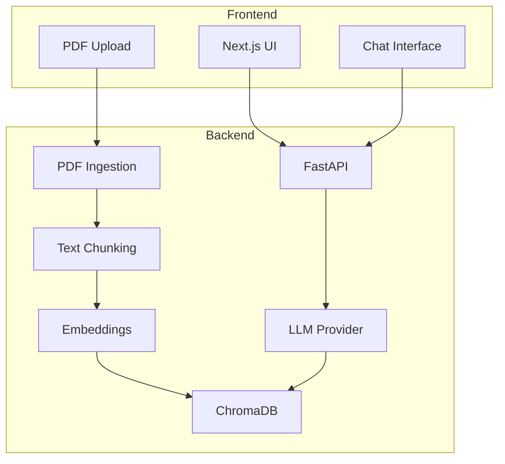

# Docsage

PDF Q&A agent using LangChain.

[](https://python.org)
[](https://nextjs.org)
[](https://fastapi.tiangolo.com)

## Architecture



## Features

- PDF upload with automatic processing
- Intelligent document chunking
- Vector search with ChromaDB
- RAG endpoint with page citations
- Next.js frontend with chat interface
- Support for OpenAI-compatible LLM providers
- Accuracy evaluation with 10 test questions

## Getting Started

### With Docker Compose

```bash
cp .env.example .env
# Configure your API keys
docker-compose up --build
```

### Local Development

**Backend:**
```bash
cd backend
python -m venv venv
venv\Scripts\activate
pip install -e ".[dev]"
uvicorn app.main:app --reload
```

**Frontend:**
```bash
cd frontend
npm install
npm run dev
```

## Project Structure

```
docsage/
├── backend/          # FastAPI backend
│   ├── app/
│   │   ├── api/      # Endpoints
│   │   ├── services/ # PDF, Vector Store, LLM
│   │   └── config.py
│   └── tests/
├── frontend/         # Next.js frontend
│   └── src/
├── evals/            # System evaluation
└── docker-compose.yml
```

## API Endpoints

- `POST /api/upload` - Upload PDF
- `POST /api/ask` - Ask questions about documents
- `GET /health` - Health check

## Testing

```bash
cd backend
pytest tests/ -v
```

## License

MIT