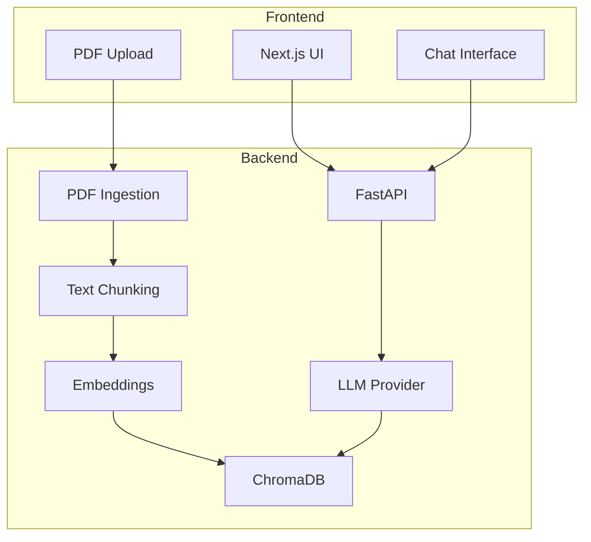

# Docsage

Agente de perguntas e respostas sobre PDFs usando LangChain.

[](https://python.org)
[](https://nextjs.org)
[](https://fastapi.tiangolo.com)

## Arquitetura



## Features

- Upload de PDFs com processamento automático
- Chunking inteligente de documentos
- Busca vetorial com ChromaDB
- Endpoint RAG com citações de página
- Frontend Next.js com interface de chat
- Suporte a provedores LLM compatíveis com OpenAI
- Avaliação de precisão com 10 perguntas de teste

## Como Rodar

### Com Docker Compose

```bash
cp .env.example .env
# Configure suas chaves de API
docker-compose up --build
```

### Desenvolvimento Local

**Backend:**
```bash
cd backend
python -m venv venv
venv\Scripts\activate
pip install -e ".[dev]"
uvicorn app.main:app --reload
```

**Frontend:**
```bash
cd frontend
npm install
npm run dev
```

## Estrutura do Projeto

```
docsage/
├── backend/          # FastAPI backend
│   ├── app/
│   │   ├── api/      # Endpoints
│   │   ├── services/ # PDF, Vector Store, LLM
│   │   └── config.py
│   └── tests/
├── frontend/         # Next.js frontend
│   └── src/
├── evals/            # Avaliação do sistema
└── docker-compose.yml
```

## API Endpoints

- `POST /api/upload` - Upload de PDF
- `POST /api/ask` - Perguntas sobre documentos
- `GET /health` - Health check

## Testes

```bash
cd backend
pytest tests/ -v
```

## License

MIT
